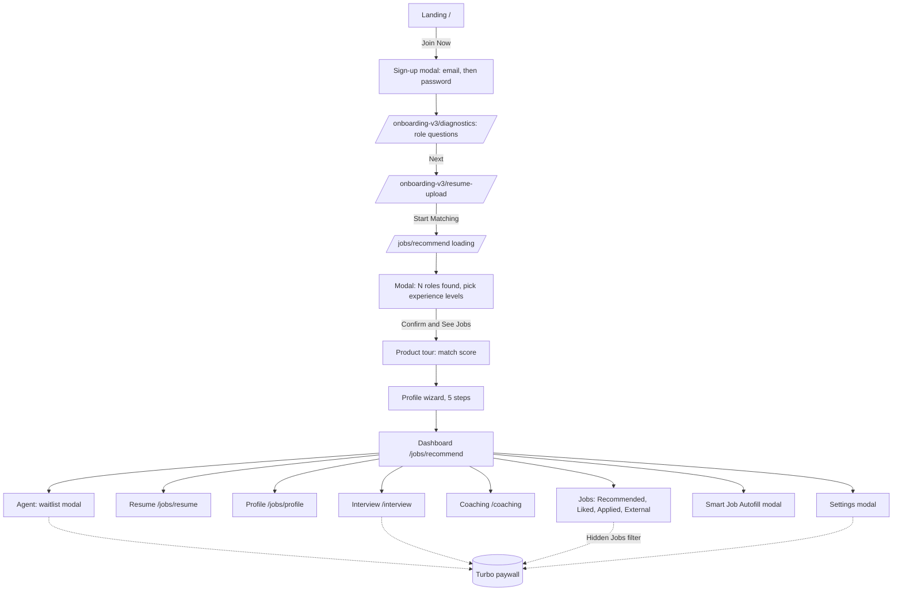

# Jobright.ai product flow: build spec for a similar app

This is a UX map of jobright.ai, an AI job-search tool, captured on 2026-10-14 by clicking through as a new free user. It covers screens, fields, buttons and navigation only, with no source code. Use it as the scaffold for building a similar app. Screenshots are in `screenshots/` and are named by step number.

## 1. Flow diagram

## 2. Onboarding screens (in order)

| # | Route | Screen | Inputs | Primary action | Next | Screenshot |
|---|---|---|---|---|---|---|
| 1 | `/` | Landing page with hero, stats, features, testimonials and FAQ | none | "Join Now" | Sign-up modal | 01-landing.png |
| 2 | `/?from=homepage` (modal) | "Welcome to Jobright" | Google sign-in, or email then password (letters and numbers, 8+ characters) | "Sign Up" | Step 3 (no email verification) | 02-signup.png |
| 3 | `/onboarding-v3/diagnostics` | "What type of role are you looking for?" | Job function (typeahead with a category browser), job type (Full-time, Contract, Part-time, Internship), location (defaults to anywhere in the US or remote) | "Next" | Step 4 | 03-onboarding-diagnostics-job-type.png |
| 4 | `/onboarding-v3/resume-upload` | "One last step: upload your resume" | Resume file | "Start Matching" | Step 5 | 04-onboarding-resume-upload.png |
| 5 | `/jobs/recommend` | Loading spinner while jobs are matched | none | none | Step 6 | 05-jobs-recommend-loading.png |
| 6 | modal | "Welcome! We found N roles that fit you" | Experience-level checkboxes (Intern/New Grad, Entry, Mid, Senior, Lead/Staff, Director/Exec), optional LinkedIn URL | "Confirm & See Jobs" | Step 7 | 06-welcome-experience-levels-modal.png |
| 7 | overlay | Product tour explaining the match score, led by the AI assistant "Orion" | none | Next or Exit | Step 8 | 09-tour-match-score-popup.png |
| 8 | modal wizard | "Complete Your Profile" with 5 steps, prefilled from the parsed resume | (a) Personal: name, email, phone, address, optional links. (b) Education. (c) Work experience. (d) Skills as chips. (e) Equal-employment questions: work authorisation, sponsorship, disability, veteran status, gender, race, pronouns | "Next" on each step | Dashboard | 13, 14, 15, 16, 17 |

## 3. Dashboard (left sidebar navigation)

| Item | Route | What it shows | Key actions |
|---|---|---|---|
| Jobs, Recommended | `/jobs/recommend` | Job cards with match %, company, salary and tags. Filter bar: location, job function, experience, job type, on-site/remote, date posted, industry, years of experience, Hidden Jobs (paid) and All Filters, plus sort. Right rail: saved filters and profile progress | Ask Orion, Apply with Autofill or Easy Apply, save, dismiss |
| Jobs, Liked | `/jobs/liked` | Saved jobs with Active and Closed tabs, and an empty state | "View Recommended Jobs" |
| Jobs, Applied | `/jobs/applied` | Application tracker with Applied, Interviewing, Offer Received, Rejected and Archived | Move jobs between stages |
| Jobs, External | `/jobs/external` | Paste a job link from another site | "Add Job" |
| Resume | `/jobs/resume` | Up to 5 resumes, one marked Primary, each with an AI analysis status | "Add Resume" |
| Profile | `/jobs/profile` | Tabs: Personal, Education, Work Experience, Skills, Equal Employment | Edit buttons, Complete Profile, Manage My Resume, Update LinkedIn URL |
| Agent | modal only | "Introducing Jobright Agent", a waitlist upsell | "Skip Waiting and Enable Agent Now" (paid) |
| Coaching | `/coaching` | Coach listings | "Meet My Coach", then 30-minute 1:1 sessions at $79.99 with "Book Now" |
| Interview (NEW) | `/interview`, `/interview/{companyId}` | Interview question bank for about 500 companies, filterable by topic and seniority | Locked behind the paid plan |
| Smart Job Autofill | modal | "Apply 5x faster" | "Enable Autofill" (browser-extension install) |
| Settings | modal | Login & Security, Subscription, Interview Passes, Job Alerts, Email Providers (connect Gmail), Privacy, Log Out | Reset password, Delete account, Upgrade |
| Top bar | modal | "Upgrade to Turbo" paywall comparing Free and Turbo | $17.99/week, $39.99/month, $89.99/3 months |
| Floating button | bottom-right | Orion AI chat assistant | Ask questions about jobs |

## 4. Suggested data model

- **User**: email, password hash, auth provider, plan (free or turbo).
- **Preferences**: job function, job types, locations, remote flag, experience levels.
- **Resume**: file, parsed fields, isPrimary, analysis status (max 5 per user).
- **Profile**: personal details, education[], experience[], skills[], equal-employment answers.
- **Job**: title, company, location, salary, type, posted date, source URL, tags.
- **Match**: user, job, score %, reasons.
- **Application**: user, job, stage (saved, applied, interviewing, offer, rejected, archived).
- **Subscription**: plan, period, price, status.

## 5. Things that were not captured

- The job detail page, the Orion chat panel, Messages and Feedback didn't visibly open, so their designs are unknown.
- How the Applied tracker moves jobs between stages wasn't tested, because no jobs were applied to.
